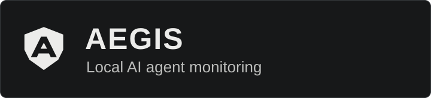
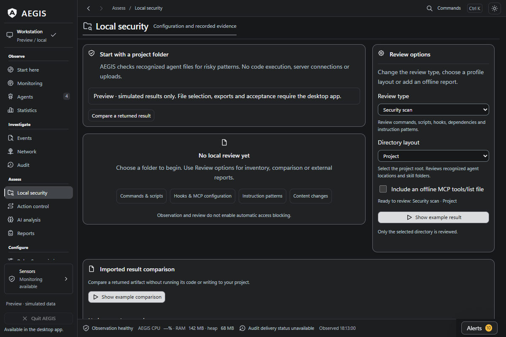

<p align="center">
  
</p>

Local AI-agent monitoring, security reviews and explicitly configured action controls.

[Install](#install) · [Use AEGIS](#use-aegis) · [Current development](#current-development) · [Documentation](docs/README.md) · [Contribute](#contribute)

> **Windows beta:** [0.19.2-beta](https://github.com/antropos17/Aegis/releases/tag/aegis-v0.19.2-beta), published 6 October 2026.
> [Verify the installer](docs/RELEASE-VERIFICATION.md) · [Beta readiness](docs/BETA-READINESS.md)
>
> **Current source version**: 0.21.0-beta <!-- x-release-please-version -->
> Later source work is described below. Installed builds contain the features at their release tag.

<a id="capabilities-at-a-glance"></a>
<a id="what-aegis-observes"></a>
<a id="monitor-first"></a>
<a id="observe-your-agents"></a>
<a id="review-before-use"></a>
<a id="control-selected-actions"></a>

## What AEGIS does

| Area | Coverage |
| --- | --- |
| Processes | 112 agents (265 process-name signatures), process trees, IDE-host and extension detection; Windows primary, macOS/Linux experimental |
| Files | Changes in configured sensitive directories and agent config paths; Windows open-handle and Restart Manager observations |
| Network | TCP endpoints for detected agent PIDs, endpoint names and `allowlisted` / `unknown` / `flagged` verdicts |
| Behavior | 73 sensitive-path detection rules across 8 categories, rolling 10-session baselines, anomaly scoring and sequence evidence |
| Resources and usage | CPU/RAM charts, local LLM probes, Claude Code token subtotals and estimated costs |
| Runtime inventory | Running WSL distribution names and local Docker/Linux-native Podman candidates; explicit freshness, no guest process inspection |
| Local review | Project, skill and profile inventory; static findings, saved snapshot comparison and offline report import |
| Investigation | Agent instances, file/network views, alerts, audit history, statistics and JSON/CSV/HTML/ZIP exports |

Monitoring requires no agent plugin or subscription. Default monitoring observes
and logs; it does not automatically block commands or contain agents. Kill,
suspend and resume are manual actions. See the [full capability guide](docs/CAPABILITIES.md).

<a id="download"></a>

## Install

<a id="windows-installer"></a>

### Windows

Download the installer, `manifest.json` and `manifest.json.sig` from the same
[GitHub release](https://github.com/antropos17/Aegis/releases), then follow
[offline verification](docs/RELEASE-VERIFICATION.md). Release notes describe that
installer's features.

Install the first beta manually after verification: the published 0.17.0-alpha
updater cannot discover beta releases. When upgrading from 0.14.1-alpha or older,
install 0.15.0-alpha or newer manually before using signed in-app updates.

### From source

Requires Node.js 24.16.0 or later in the 24.x line. Source uses Electron 44 and
64-bit platforms; macOS requires version 13 or later. Windows 10/11 is primary;
macOS/Linux remain experimental.

```bash
git clone https://github.com/antropos17/Aegis.git
cd Aegis
npm ci
npm start
```

On Windows, run `npm run build:sidecar` after `npm ci` for native Job/MCP routes
and native-helper tests. Linux process actions additionally require Python 3.9+
at /usr/bin/python3 and kernel pidfd support; see [Linux process control](docs/development/linux-process-control.md).
The [development workflow](docs/development/workflow.md) covers helper builds and checks.

<a id="try-without-ai-agents"></a>

### Browser preview

```bash
npm run dev
# open http://127.0.0.1:8770
```

The preview shares desktop components and uses simulated data with an isolated
host. It disables native exports and provider requests. `npm run frontend:build:preview`
builds that preview; `npm run build:renderer` builds the desktop renderer.

<a id="start-with-a-task"></a>

## Use AEGIS

Source opens **Advanced** navigation by default. **Simple interface** in Settings
offers investigation, file checks and settings; a saved Simple choice is retained.

| Task | Start here |
| --- | --- |
| See agents and their activity | **Monitoring**, then an agent's processes, files or connections |
| Review a sensitive-file alert | **Alerts**, then [inspect the captured evidence](docs/ALERTS-AND-PERMISSIONS.md) |
| Inspect a Windows file read | **Events** → **Folder to monitor** → **Start file read monitoring**; [setup and limits](docs/development/ordinary-file-reads.md) |
| Review a project, skill or profile | [**Local security**](docs/LOCAL-SECURITY-UI.md) |
| Check a selected action against a policy | [**Action control**](docs/ACTION-COVERAGE-UI.md) |
| Configure selected-action MCP tools | [Terminal setup](docs/ACTION-MCP-CONFIG.md) |
| Find other tools | **Start here** or **Commands** (Ctrl K); [workspace guide](docs/OBSERVATORY-GUIDED-WORKFLOWS.md) |

| Monitoring | Local security |
| --- | --- |
| [](docs/screenshots/01-monitoring.png) | [](docs/screenshots/04-local-security.png) |

These are simulated source UI captures from 11 October 2026.
[All screenshots and provenance](docs/screenshots/README.md).

Windows x64 packages include experimental Kernel-File reads. In **Events**, choose
a local folder and explicitly start capture with manual UAC consent. It stays off
on startup and stops on Stop, monitoring pause, suspend or quit. Events can display
a read, its verified issuing agent and
**Potential sensitive read** from path rules. Paths remain candidates, and the
label does not establish malicious intent or change risk scores.

Monitoring data stays local, with no usage telemetry or cloud sync. Endpoint
naming uses DNS; update checks contact GitHub. Optional Anthropic analysis sends
activity metadata on request using your own API key and incurs that service's
charges. See [privacy and key handling](SECURITY.md#privacy-architecture).

<a id="opt-in-action-control"></a>

## Selected action controls

These routes require explicit setup and cover selected actions only. They do not
intercept other agent tools, arbitrary MCP traffic or activity outside the route.

| Route | Scope |
| --- | --- |
| [Exact execution policy and terminal review](docs/ACTION-EXECUTION.md) | One selected CLI action; policy deny and failed preparation do not launch. [Fresh confirmation](docs/ACTION-CONFIRMATION.md) can be required per attempt |
| [Windows Job lifetime](docs/ACTION-EXECUTION.md#opt-in-windows-job-lifetime-route) | Confirmed cleanup of ordinary Job-member descendants; caller file/network privileges are retained |
| [Windows AppContainer](docs/ACTION-APPCONTAINER.md) | One reviewed offline action in a new retained workspace, zero capabilities, private-file access checks and Job cleanup |
| [Selected-action MCP tools](docs/ACTION-MCP-CATALOG.md) | Up to eight fixed argument-free tools, optional [review broker](docs/ACTION-MCP-REVIEW.md), [configuration checks](docs/ACTION-ROUTE-CHECK.md) and [connection status](docs/ACTION-MCP-STATUS.md) |
| [Validating MCP gateways](docs/MCP-STDIO-GATEWAY.md) | Explicit stdio, [loopback HTTP](docs/MCP-HTTP-GATEWAY.md) and [pinned HTTPS](docs/MCP-HTTPS-GATEWAY.md); accepted catalogs and bounded grants |
| [Reviewed file deletion](docs/ACTION-DELETE-FILE.md) | One exact AEGIS-owned file operation with mandatory terminal confirmation |

Optional [persistent grants](docs/MCP-DURABLE-GRANTS.md),
[known-secret checks](docs/MCP-KNOWN-SECRETS.md) and
[live route observation](docs/ACTION-LIVE-OBSERVATION.md) have separate contracts.
Configuration checks grant no execution permission; observation does not verify
provider identity or blocking. Client settings stay under operator control.
Terminal previews and generated configurations can contain private paths or
secrets, so keep them private. [Setup guides](docs/README.md#configure-selected-actions).

## Experimental protected Windows guests

Administrative repository APIs can create a private Hyper-V VM, hydrate its
original disk from a trusted Windows VHDX, and run one bounded executable as a
fresh standard guest user. Actual boot, quota refusal, descendant cleanup and VM
removal passed on the [recorded source](docs/roadmap/enforcement-e2/protected-guest-hosted-evidence-20261016.md).

The guest has no NICs, a private desktop, a 512 MiB allocation quota, a
32-process/512 MiB Job and a 120-second run limit. These require an administrative
disposable lab. Ordinary installed-caller launch stays disabled
(`launchAllowed=false`); complete session integration and independent A1–A4
acceptance remain open. [Administrative contract](docs/roadmap/enforcement-e2/protected-guest-start.md)
· [Protection roadmap](docs/roadmap/ai-agent-protection.md).

<a id="latest-source"></a>

## Current development

Snapshot: 18 October 2026, merged through [#975](https://github.com/antropos17/Aegis/pull/975)
at [master `96b63b16`](https://github.com/antropos17/Aegis/tree/96b63b165ac932e9615815f93c587765e6bde1b8).
[Changes since the beta](https://github.com/antropos17/Aegis/compare/aegis-v0.19.2-beta...96b63b165ac932e9615815f93c587765e6bde1b8).
Each evidence record identifies its own tested revision and package.

| Area | Merged work |
| --- | --- |
| Development context | [#960](https://github.com/antropos17/Aegis/pull/960) aligns context and skills; [#962](https://github.com/antropos17/Aegis/pull/962) adds Windows fixture CI. [Contributor workflow](docs/development/workflow.md) |
| Packaged monitoring | [#963](https://github.com/antropos17/Aegis/pull/963) checks the built window and Start/Query/Stop; [#964](https://github.com/antropos17/Aegis/pull/964) fixes startup freshness. [Evidence boundary](docs/development/packaged-desktop-milestone.md) |
| File and TCP sensors | [#965](https://github.com/antropos17/Aegis/pull/965) refreshes TCP observations after settings changes and checks owned file/socket activity. [Packaged journey](docs/development/packaged-desktop-milestone.md#packaged-file-and-network-sensors) |
| Diagnostic ETW | [#966](https://github.com/antropos17/Aegis/pull/966)–[#973](https://github.com/antropos17/Aegis/pull/973) test scoped reads and recovery after helper, main and custodian loss. [Recovery limits](docs/roadmap/etw-durable-recovery.md) |
| Genuine agent read | [#975](https://github.com/antropos17/Aegis/pull/975) verifies installed Claude Code reading a synthetic .env after a preparatory README read, with a visible read, issuer and potential risk. [Live record](docs/recon/evidence/agent-sensitive-read.json) |

**Pending:** [#974](https://github.com/antropos17/Aegis/pull/974) remains draft until
an actual Windows restart and post-restart capture pass.

[#976](https://github.com/antropos17/Aegis/pull/976) prepares detected threads
before the first scoped read. Its [live qualification](docs/recon/evidence/agent-first-read-preparation.json)
passed the genuine first-read journey without README warmup and the persistent-read
regression on one diagnostic Windows package. Both showed a verified agent read
and potential risk; additional observations can remain unverified. This candidate
was tested with the diagnostic profile. Ordinary packaged controls have their own
[setup and qualification](docs/development/ordinary-file-reads.md).

The [idle first-read qualification](docs/recon/evidence/agent-idle-first-read.json)
passes genuine Claude Code reads after 65, 70 and 85 seconds in an ordinary package,
with verified issuer, visible action/potential risk and cleanup. It covers renewed
original handles; the [earlier attribution failure](docs/recon/evidence/ordinary-agent-sensitive-read.json)
is retained. Collector drops remain separate from kernel loss; these passes do
not establish complete capture or attribution of every worker.

<a id="the-evidence-graph"></a>

## Known limits

- **Coverage:** Unknown signatures and short-lived processes can be missed. Default monitoring does not parse individual tool calls. Healthy sensors or a valid audit chain do not prove complete capture.
- **Platform identity:** macOS lacks a process-birth witness. Linux depends on accessible /proc data; fallback lacks a start-time witness. Missing identity limits attribution and process actions.
- **File evidence:** Candidate paths do not resolve reparse targets. A first read, new worker or unavailable native witness can remain unverified. Diagnostic reads do not enter risk scoring, FileEvents, audit, baselines or sequences.
- **History and recovery:** UI windows are bounded; Statistics exposes eviction counts and Audit retains persisted records. File-watch retries and ETW recovery have bounded, scenario-specific limits; observation gaps remain explicit.
- **Token usage:** Claude Code requires a matching process lifetime and readable session data. Bounded reads, oversized records and index capacity can leave subtotals incomplete; other-agent values and dollar amounts can be estimates. [Accounting and soak limits](docs/development/token-accounting-soak.md)
- **Privacy:** Paths, agent names and endpoints can appear in logs and exports. API-key storage depends on a secure safeStorage backend; [security guidance](SECURITY.md) explains the boundary.
- **Unmeasured behavior:** No overall detection rate, false-positive rate, startup-time guarantee or whole-app overhead figure has been established. Static findings and scores do not establish safety.

<a id="development-and-roadmap"></a>

## Contribute

Start with [CONTRIBUTING.md](CONTRIBUTING.md), the
[current development context](docs/development/current-context.md) and
[code conventions](CODING_STANDARDS.md). Main uses CommonJS JavaScript; the Svelte
renderer and shared types use TypeScript. Exact versions and scripts are in
[package.json](package.json).

Use an isolated branch, preserve existing work and describe actual validation in
your PR. `npm test` runs the configured suite; `npm run counts:check` checks
maintained declarations. CI also runs builds, lint, type checks, dependency audit
and the identity/sequence mutation gates. Native and provider scenarios need their
own matching evidence. [Architecture](ARCHITECTURE.md) · [Roadmap](ROADMAP.md).

<a id="contributors"></a>
<a id="support-and-license"></a>

## Community and license

[Bug report](https://github.com/antropos17/Aegis/issues/new?template=01-bug-report.yml)
· [Feature request](https://github.com/antropos17/Aegis/issues/new?template=02-feature-request.yml)
· [Discussions](https://github.com/antropos17/Aegis/discussions)
· [Private vulnerability report](https://github.com/antropos17/Aegis/security/advisories/new)

[MIT license](LICENSE) · [Code of conduct](CODE_OF_CONDUCT.md) ·
[All contributors](https://github.com/antropos17/Aegis/graphs/contributors).
Navigation icons use a curated Tabler subset with its
[MIT notice](frontend/observatory/vendor/tabler-icons.LICENSE) and
[pinned provenance](frontend/observatory/vendor/tabler-icons.provenance.json).

## Star history

[](https://www.star-history.com/?repos=antropos17%2FAegis&type=timeline&legend=top-left)
