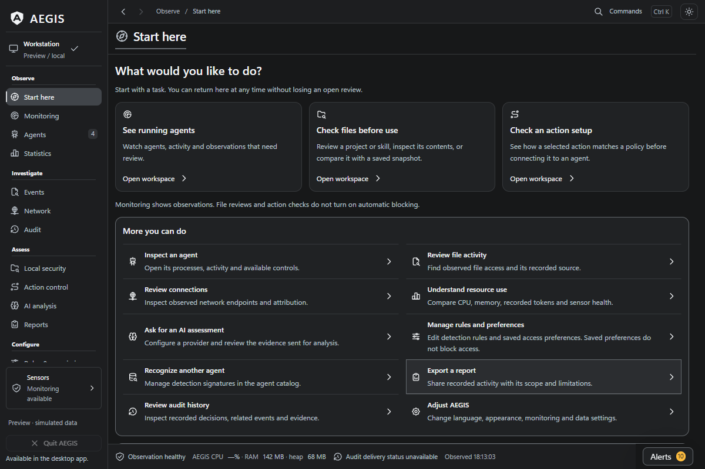

<p align="center">
  
</p>

<p align="center">
  Local AI-agent monitoring, security reviews and explicitly configured action controls.
</p>

<p align="center">
  <a href="#capabilities-at-a-glance">Features</a> ·
  <a href="#download">Install</a> ·
  <a href="#start-with-a-task">Get started</a> ·
  <a href="docs/README.md">Documentation</a> ·
  <a href="#latest-source">Latest changes</a>
</p>

> **Windows beta:** [0.19.2-beta](https://github.com/antropos17/Aegis/releases/tag/aegis-v0.19.2-beta), published 6 October 2026.
> [Verify the installer](docs/RELEASE-VERIFICATION.md) · [Beta readiness](docs/BETA-READINESS.md)
>
> **Current source version**: 0.19.2-beta <!-- x-release-please-version -->
> This page includes later source work. Installed builds contain the features at their release tag.

## Capabilities at a glance

### Observe your agents

Follow agent instances and process trees, sensitive-file events, TCP connections
and attribution evidence. Inspect the live radar, CPU/RAM charts, Claude Code
token subtotals and estimated costs. WSL and local Docker/Linux Podman metadata
have explicit freshness and coverage limits.

### Review before use

Check selected projects, skills and agent profiles locally. Inventory components,
review static findings, compare snapshots and import offline reports. Follow
rules, baselines, anomalies and sequence evidence; search audit history and
export JSON, CSV, HTML or diagnostic ZIP reports.

### Control selected actions

Configure exact CLI action policies, terminal approval, Windows Job lifetime
controls or an offline AppContainer launch. Connect selected-action MCP tools,
or configure a validating stdio/HTTP(S) gateway with accepted catalogs, bounded
grants and optional known-secret checks.

| Entry point | Availability |
| --- | --- |
| **Observatory desktop** | Local monitoring and review; Windows primary, macOS/Linux experimental |
| **CLI / MCP** | Explicit setup for selected actions and connections |
| **Hyper-V guest APIs** | Experimental administrative lab path; ordinary desktop launch disabled |

Monitoring requires no agent plugin. Default monitoring does not automatically
intercept or block commands. [Full capability guide →](docs/CAPABILITIES.md)

<p align="center">
  <a href="docs/screenshots/01-monitoring.png"></a>
</p>
<p align="center"><sub>Observatory source UI preview · simulated data · 11 October 2026</sub></p>

## Download

### Windows installer

Get the current prerelease from [GitHub Releases](https://github.com/antropos17/Aegis/releases).
A complete Windows download contains the `.exe`, `manifest.json` and
`manifest.json.sig`. Download them from the same release and
follow [offline installer verification](docs/RELEASE-VERIFICATION.md). Check
that release's notes for the features it contains; this README describes current
source, which may be ahead of the installer.

When upgrading from 0.14.1-alpha or older, install 0.15.0-alpha or newer
manually before using signed in-app updates.
The published 0.17.0-alpha updater cannot discover beta releases: install the
first beta manually after [verifying its installer](docs/RELEASE-VERIFICATION.md).
The source updater keeps beta installations on newer beta or stable releases.

### From source

Requires **Node.js 24.x**. Windows 10/11 is the primary platform; macOS/Linux support is experimental.

Linux process actions (pause, resume and terminate) additionally require
`/usr/bin/python3` 3.9+ and kernel `pidfd` support. The generation is checked
against the pinned process handle; unavailable support returns an explicit error.
See [Linux process control](docs/development/linux-process-control.md).
Source builds use Electron 44, which requires 64-bit platforms and macOS 13 or later.
The published 0.19.2-beta Windows installer uses Electron 44.5.1.

```bash
git clone https://github.com/antropos17/Aegis.git
cd Aegis
npm ci
npm start
```

On Windows, run `npm run build:sidecar` after `npm ci` when using native Job/MCP
routes or native-helper tests. The [development workflow](docs/development/workflow.md)
describes helper builds and platform-specific verification. Administrative VM
qualification has additional disposable-lab prerequisites and changes accounts,
services and VM storage; it is separate from ordinary desktop setup.

### Try without AI agents

After installing dependencies, build and preview the browser demo:

```bash
npm run dev
# open http://127.0.0.1:8770
```

The preview uses simulated data and an isolated host. It shares the desktop components, never calls the real preload, and disables native exports and provider requests. `npm run frontend:build:preview` creates a static preview; `npm run build:renderer` creates the desktop artifact without fixtures.

See [GitHub Releases](https://github.com/antropos17/Aegis/releases) for the full
release history and each installer's changes.

## Start with a task

Current source opens the full **Advanced** navigation by default. An optional
**Simple interface** in Settings brings investigation, file checks and settings
together; an explicitly saved Simple choice is retained.

| What you want to do | Where to start |
| --- | --- |
| See running agents and review their activity | **Monitoring**, then an agent's processes, files or connections |
| Review a sensitive-file alert | **Alerts** in Observatory, then [inspect the captured evidence](docs/ALERTS-AND-PERMISSIONS.md) |
| Inspect a Windows diagnostic file read | **Events** in a marked diagnostic build; [setup, evidence and limits](docs/development/agent-sensitive-read.md) |
| Check a project, skill or agent profile before use | [**Local security**](docs/LOCAL-SECURITY-UI.md): static review, inventory, comparison and offline report import |
| Check how a selected action matches a policy | [**Action control**](docs/ACTION-COVERAGE-UI.md): choose files and review the captured outcome |
| Connect selected actions to an agent | [MCP setup](docs/ACTION-MCP-CONFIG.md), explicitly configured from a terminal |
| Explore settings, reports and the other tools | **Start here** in the sidebar, or **Commands** (`Ctrl K`) |

The [workspace guide](docs/OBSERVATORY-GUIDED-WORKFLOWS.md) explains tasks and
captured results. Static file reviews and route/catalog checks do not execute
commands or establish safety. The published installer can contain an earlier UI.

<details>
<summary>More Observatory views</summary>




These views use simulated preview data. [More screenshots](docs/screenshots/README.md).

</details>

## What AEGIS observes

<details>
<summary>Sensor coverage, resources and investigation views</summary>

| Layer | Coverage |
| --- | --- |
| Processes | 112 agents (265 process-name signatures), parent-chain, IDE-host and IDE-extension detection; passive WSL inventory does not inspect guest processes |
| Files | Changes in configured sensitive directories and agent config paths; Windows open-handle and Restart Manager observations |
| Network | TCP endpoints for detected agent PIDs, forward-confirmed reverse DNS, and `allowlisted` / `unknown` / `flagged` verdicts |
| Behavior | 73 sensitive-path detection rules across 8 categories, rolling 10-session baselines, anomaly scoring and sequence correlations |
| Local LLMs | Ollama and LM Studio runtime probes; other supported runtimes detected by process signature |
| Runtime inventory | Running WSL distribution names; local Docker and Linux-native Podman candidates from image metadata, with selected configuration observations and explicit freshness |
| Token usage | Claude Code usage from matching local session data, with durable deduplication, incomplete-coverage indicators and estimated dollar amounts |

The Observatory workspace provides a live instance radar, separate agent instances, file and network views, rules, custom agent catalog, AI analysis, reports, audit, statistics and settings. Activity can be filtered and grouped, inspected by stamped instance identity, and exported to JSON, CSV, HTML or ZIP. The [agent database](src/shared/agent-database.json) and [contributor guide](CONTRIBUTING.md#how-to-add-a-new-agent) describe how to extend detection.

Current source adds [Liveline-inspired charts](frontend/observatory/DESIGN-HISTORY.md#live-chart-refinement--5-october-2026) to Statistics and agent Resources: short smooth updates, endpoint values, interval buttons and actual-point inspection. Missing readings, coverage, pause and reduced motion remain explicit.

</details>

Windows Kernel-File reads use a separate opt-in diagnostic route. A marked build,
an explicit test root and manual UAC consent are required; ordinary packages keep
this capture disabled. **Events** can show an observed read, its verified issuing
agent and a **Potential sensitive read** label from path rules. Paths remain
candidates, and that label does not establish malicious intent or change risk
scores. See the [packaged agent-read guide](docs/development/agent-sensitive-read.md)
for tested scenarios and pending first-read qualification.

## Monitor-first

Default monitoring observes and logs; it does not automatically block or contain agents. Kill, suspend and resume are manual actions. Monitoring presets and endpoint allowlists do not establish that an agent is safe. The opt-in routes below control only selected launches. The Windows Job route bounds the lifetime of its participating descendants. The separate AppContainer CLI route adds Windows access restrictions for one reviewed offline action in a new workspace; other execution routes retain caller privileges.

The [sensitive-activity review list](docs/ALERTS-AND-PERMISSIONS.md) is scoped to the current desktop window; marking an alert reviewed does not quarantine its file or grant access.

Monitoring data stays local, with no usage telemetry or cloud sync. Endpoint
naming uses DNS queries; update checks contact GitHub. Optional AI analysis sends
activity metadata to Anthropic on request using your own API key. See
[privacy and key handling](SECURITY.md#privacy-architecture).

## Opt-in action control

Choose the route for your selected action. The [setup guides](docs/README.md#configure-selected-actions) cover policy files, terminal review and client configuration.

<details>
<summary>Compare action routes, MCP gateways and configuration checks</summary>

An operator can select an exact executable, working directory, arguments and
environment, then route that action through AEGIS:

| Capability | Implemented scope |
| --- | --- |
| [Exact execution policy](docs/ACTION-EXECUTION.md) | Explicit CLI launch on `allow`; `ask`, `deny` and preparation failures do not launch |
| [Windows AppContainer launch](docs/ACTION-APPCONTAINER.md) | Explicit terminal approval for one bounded offline action in a new retained workspace; private-file access checks, zero capabilities and Job cleanup |
| [Windows Job lifetime route](docs/ACTION-EXECUTION.md#opt-in-windows-job-lifetime-route) | An approved selected Windows action starts inside a private Job; confirmed cleanup ends ordinary Job-member descendants. External brokers and actions outside this route remain outside its control |
| [Terminal confirmation](docs/ACTION-CONFIRMATION.md) | Review the complete effective action and confirm one launch attempt; policy deny cannot be overridden |
| [Selected-action MCP catalog](docs/ACTION-MCP-CATALOG.md) | Up to eight operator-selected actions with empty tool arguments; optional [terminal review broker](docs/ACTION-MCP-REVIEW.md) requires fresh confirmation per eligible call |
| [Route and catalog checks](docs/ACTION-ROUTE-CHECK.md) | Inspect selected configuration and current-process prerequisites without executing; a completed check grants no permission |
| [MCP connection status](docs/ACTION-MCP-STATUS.md) | Read-only counters for the current connection's admitted calls, pending work and cancellation requests |
| [Action control workspace](docs/ACTION-COVERAGE-UI.md) | Native file selection and nonexecuting route/catalog checks in Observatory; shows captured policy outcomes, explicit unverified coverage and a configuration-check link when setup is missing |
| [Live route observation](docs/ACTION-LIVE-OBSERVATION.md) | Opt-in desktop observation of one running MCP owner; self-reported client metadata, bounded counters and coverage loss; blocking and provider identity remain unverified |
| [Validating MCP gateways](docs/MCP-STDIO-GATEWAY.md) | Explicit stdio, [loopback HTTP](docs/MCP-HTTP-GATEWAY.md) and [pinned HTTPS](docs/MCP-HTTPS-GATEWAY.md) routes with accepted catalogs, finite schema checks and exact grants; optional [persistent grant binding](docs/MCP-DURABLE-GRANTS.md) and [known-secret checks](docs/MCP-KNOWN-SECRETS.md) |
| [Reviewed file deletion](docs/ACTION-DELETE-FILE.md) | One exact AEGIS-owned file operation with mandatory terminal confirmation; also available through a dedicated argument-free terminal MCP tool |

These routes do not cover other agent tools, arbitrary MCP traffic or activity
outside the selected actions. Direct execution and the ordinary Windows Job route
retain the caller's account privileges. The separate AppContainer route adds the
access restrictions described above. Terminal previews can expose secrets in local
scrollback; terminal automation does not establish human identity. Client settings
are not changed automatically. The linked contracts explain configuration, limits and verification.

After creating a catalog, generate a client configuration from the source checkout
(PowerShell 7 example):

```powershell
node src/main/main.js --action-mcp-config-json catalog "X:/private/actions/catalog.json" > aegis-mcp.json
```

The [configuration generator](docs/ACTION-MCP-CONFIG.md) prints an
`mcpServers.aegis` entry using the current Node executable and absolute source
entry path. Load the generated file explicitly in a client that accepts this
configuration format; client setup requirements vary. The output intentionally
contains local paths, so keep it private. Generation does not read or validate the
catalog, start a server or install settings; run the appropriate route/catalog
check separately.

</details>

## Experimental protected Windows guests

Actual Windows boot and a bounded standard-user agent run passed [hosted qualification](docs/roadmap/enforcement-e2/protected-guest-hosted-evidence-20261016.md). These are administrative repository APIs. Ordinary installed-caller launch remains disabled: `launchAllowed=false`.

<details>
<summary>Guest limits, lifecycle and remaining integration</summary>

The repository's administrative APIs can create a fresh private Hyper-V VM,
hydrate its original disk from a trusted Windows VHDX, start it through the
retained native owner and run one bounded executable as a fresh ordinary guest
user. The guest has no NICs. The agent has a private desktop, explicit environment,
an enforced 512 MiB NTFS allocation quota, a 32-process Job and 512 MiB aggregate
Job memory limit; its maximum run is 120 seconds. Closure must be verified before
the original VM is stopped and removed.

The [hosted qualification record](docs/roadmap/enforcement-e2/protected-guest-hosted-evidence-20261016.md)
links actual native and Windows guest/agent runs, source hashes and receipt hashes.
The [administrative contract](docs/roadmap/enforcement-e2/protected-guest-start.md)
explains trusted image/admin prerequisites, one-use admission and retained unknown
operations. There is no ordinary desktop launch or recovery API for unknown VMMS
work. These controls do not establish provider integration or production readiness.

</details>

## Latest source

Development through 18 October 2026 adds packaged monitoring and sensor fixes,
ETW recovery checks and a real Claude Code sensitive-read journey. These changes
follow the published beta; they are not included in that installer's release tag.
[Browse all capabilities](docs/CAPABILITIES.md).

<details>
<summary>Merged changes through PR #975 and exact-source evidence</summary>

Merged-source snapshot: [master at `96b63b16`](https://github.com/antropos17/Aegis/tree/96b63b165ac932e9615815f93c587765e6bde1b8).
See the [release-to-source comparison](https://github.com/antropos17/Aegis/compare/aegis-v0.19.2-beta...96b63b165ac932e9615815f93c587765e6bde1b8)
for the full diff. Each linked record identifies its tested source and package;
earlier runs do not automatically qualify later changes.

| Area | Current-source change and evidence |
| --- | --- |
| Development context and verification | [#960](https://github.com/antropos17/Aegis/pull/960) aligns current context and project skills; [#962](https://github.com/antropos17/Aegis/pull/962) adds Windows fixture CI and lifecycle reports. Start with the [current context](docs/development/current-context.md) and [verification workflow](docs/development/workflow.md). |
| Packaged desktop and monitoring | [#963](https://github.com/antropos17/Aegis/pull/963) exercises the built window and Start/Query/Stop lifecycle; [#964](https://github.com/antropos17/Aegis/pull/964) fixes startup freshness across planned scan gaps. The [packaged milestone](docs/development/packaged-desktop-milestone.md) distinguishes real application observations from modeled installation authority. |
| File and network sensors | [#965](https://github.com/antropos17/Aegis/pull/965) queues a fresh TCP observation after settings changes. Its packaged scenario checks owned file changes, separate TCP sockets, instance attribution, visible rows and cleanup. See the [sensor journey](docs/development/packaged-desktop-milestone.md#packaged-file-and-network-sensors). |
| Diagnostic ETW attribution and recovery | [#966](https://github.com/antropos17/Aegis/pull/966)–[#973](https://github.com/antropos17/Aegis/pull/973) qualify bounded captures and recovery after helper, original-main and custodian loss. [Recovery evidence](docs/roadmap/etw-durable-recovery.md) retains source/package bindings and observation gaps; ordinary packaged capture remains disabled. |
| Genuine agent read and visible risk | [#975](https://github.com/antropos17/Aegis/pull/975) verifies installed Claude Code reading a newly created synthetic `.env` after a preparatory README read. Events displays the read, verified issuer and potential path-rule risk. The [live record](docs/recon/evidence/agent-sensitive-read.json) qualifies that persistent-agent scenario on its recorded package. |

Protected Windows guests remain experimental administrative APIs as described
above. Ordinary installed-caller launch stays disabled (`launchAllowed=false`);
independent A1–A4 acceptance remains open in the
[protection roadmap](docs/roadmap/ai-agent-protection.md).

</details>

**Pending qualification:** [#974](https://github.com/antropos17/Aegis/pull/974)
remains draft until an actual Windows restart and post-restart capture are tested.
[#976](https://github.com/antropos17/Aegis/pull/976) prepares detected agent threads
before their first scoped read. Its [checks without elevation](docs/recon/evidence/agent-first-read-preparation.json)
cover native handles, control exchange and an ordinary packaged launch. The real
first-read journey without README warmup and the persistent-read regression on
that candidate still require manual UAC; this PR also remains draft. Neither
pending package is part of the merged-source snapshot above.

## The evidence graph

<details>
<summary>Local review, instance identity, attribution and audit integrity</summary>

The **Local security** workspace reviews selected project/profile files, commands,
scripts and instruction patterns, compares content snapshots, and imports offline
Cisco results. It keeps incomplete coverage and unverified claims visible. See the
[workspace guide](docs/LOCAL-SECURITY-UI.md) for inputs, evidence and limitations.

- **Instance identity:** Windows uses PID and OS birth time; Linux uses boot identity and kernel process start ticks. Missing witnesses and synthetic discoveries provide weaker identity.
- **Attribution:** Records distinguish confirmed, inferred and unattributed ownership. Identity or attribution can be null when unknown or not applicable.
- **Audit trail:** Hash-chained JSONL records rotate daily and have 30-day retention. Chain verification detects edits relative to a trusted chain state; it does not guarantee that no events were lost.

See the [architecture](ARCHITECTURE.md), [correctness audit](docs/current-state/CORRECTNESS-AUDIT.md) and [dated measurements](docs/bench/) for implementation details and evidence.

</details>

## Known limits

Coverage depends on the agent, sensor and platform. Static findings, scores and unchanged hashes do not establish safety. No overall detection or false-positive rate has been measured.

<details>
<summary>Coverage gaps, privacy, token subtotals and recovery behavior</summary>

- **Incomplete coverage:** Unknown signatures and processes that start and exit between polling ticks can be missed. Default monitoring does not parse MCP traffic or individual tool calls; the explicitly configured MCP routes handle only their published AEGIS tools.
- **Platform gaps:** macOS lacks a process-generation witness. Linux generation identity depends on accessible `/proc` data; its fallback has no start-time witness. Missing identity limits process-control guarantees. Measured Claude Code usage requires a process start-time witness and a readable matching session registry/transcript. Windows is the verified primary path; native Linux token collection remains unverified.
- **Bounded UI history:** Retained event windows can differ from aggregate totals; Statistics shows renderer eviction counters; Audit provides persisted history.
- **Sensor and audit gaps:** Health status does not prove complete capture. A fully lost file-watch plan gets three fast retries, then recovery probes after a five-minute cooldown; a healthy plan resets the retry budget. Exited watch workers count as lost roots. Terminated workers in a partially live plan get up to three root-local replacement attempts per watch lifetime, with a one-second retry delay and a ten-second readiness deadline. Other partial degradation and exhausted root-local recovery require separate repair. Audit loss markers require a successful flush; process-scan overruns lack a dedicated counter.
- **Sensitive metadata:** Logs and exports contain paths, agent names and endpoints. Configuration and diagnostic exports omit the configured API key. Local key encryption depends on safeStorage availability. See [SECURITY.md](SECURITY.md).
- **Unmeasured claims:** No general detection rate, false-positive rate, startup-time guarantee or whole-app overhead figure has been established.
- **Token subtotals:** Bounded transcript reads can lag a backlog; records above 512 KiB are skipped with a fixed diagnostic. Token history retains all active records and 256 recent exited records; older records become one labeled archive preserving run totals. Compaction freezes during observation gaps. The published 0.19.2-beta uses a run-scoped 128 MiB SQLite index for transcript deduplication. Current source can retry a capacity-failed process with a smaller complete batch, while the remaining usage stays marked incomplete; accepted IDs are not evicted. Issue [#637](https://github.com/antropos17/Aegis/issues/637) is closed; long-duration qualification remains incomplete. The earlier two-hour receipt used pre-final harness bytes; [#863](https://github.com/antropos17/Aegis/pull/863) records a 15-second smoke of the final harness. See the [packaged-module qualification scope](docs/development/token-accounting-soak.md) and [token accounting limits](docs/TOKEN-ACCOUNTING.md), including incomplete coverage and estimated dollar amounts.

</details>

## Development and roadmap

<details>
<summary>Contributor commands, architecture and remaining work</summary>

Inspect a project's AI component files without starting agents or MCP servers:

```powershell
node src/main/main.js --inventory-json "X:/path/to/project"
node src/main/main.js --inventory-profile-json codex-user "X:/copied-codex-profile"
```

This produces a bounded local inventory with fingerprints, not a security
verdict. See [scope, privacy and exit codes](docs/PROJECT-INVENTORY.md) and the
[AI agent protection plan](docs/roadmap/ai-agent-protection.md).

The monitoring engine uses CommonJS JavaScript; the Svelte renderer and shared types use TypeScript. See [development setup](CONTRIBUTING.md), the [development reference](docs/DEVELOPMENT.md) and [package.json](package.json) for the stack and commands.

CI runs build, lint, type checks, tests and dependency auditing. `npm run counts:check` verifies selected inventory declarations. `npm run verify:gate` checks identity-witness behavior with fault injection (4 mutants); `npm run verify:seq-gate` checks sequence behavior. Run `npm test` for current suite results.

The [roadmap](ROADMAP.md) tracks Windows ETW experiments and remaining discovery/platform work. Source changes and isolated experiments are not automatically available in released installers.

</details>

## Contributors

<table>
  <tr>
    <td align="center"><a href="https://github.com/antropos17"><br/><sub><b>Antropos7</b></sub></a></td>
    <td align="center"><a href="https://github.com/travisbreaks"><br/><sub><b>travisbreaks</b></sub></a></td>
    <td align="center"><a href="https://github.com/MsfPablo"><br/><sub><b>MsfPablo</b></sub></a></td>
    <td align="center"><a href="https://github.com/raye-deng"><br/><sub><b>raye-deng</b></sub></a></td>
    <td align="center"><a href="https://github.com/pablo"><br/><sub><b>pablo</b></sub></a></td>
  </tr>
  <tr>
    <td align="center"><a href="https://github.com/skmelendez"><br/><sub><b>Steven Melendez</b></sub></a></td>
    <td align="center"><a href="https://github.com/anupamme"><br/><sub><b>anupamme</b></sub></a></td>
    <td align="center"><a href="https://github.com/mig-builds"><br/><sub><b>mig-builds</b></sub></a></td>
    <td align="center"><a href="https://github.com/frobel0520"><br/><sub><b>frobel0520</b></sub></a></td>
    <td align="center"><a href="https://github.com/KJyang-0114"><br/><sub><b>KJyang-0114</b></sub></a></td>
  </tr>
</table>

[CONTRIBUTING.md](CONTRIBUTING.md) &middot; [SECURITY.md](SECURITY.md) &middot; [CODE_OF_CONDUCT.md](CODE_OF_CONDUCT.md)

## Support and license

[Feature requests](https://github.com/antropos17/Aegis/issues/new?template=02-feature-request.yml) · [Private vulnerability reports](https://github.com/antropos17/Aegis/security/advisories/new) · [MIT license](LICENSE)

Local monitoring requires no account or subscription. Optional Anthropic analysis uses your own API key and is subject to that service's charges.

Navigation icons use a curated [Tabler Icons](https://github.com/tabler/tabler-icons)
subset under the [MIT notice](frontend/observatory/vendor/tabler-icons.LICENSE).
Pinned source URLs and hashes are recorded in the [icon provenance](frontend/observatory/vendor/tabler-icons.provenance.json).

<details>
<summary>Star history</summary>

[](https://www.star-history.com/?repos=antropos17%2FAegis&type=timeline&legend=top-left)

</details>
