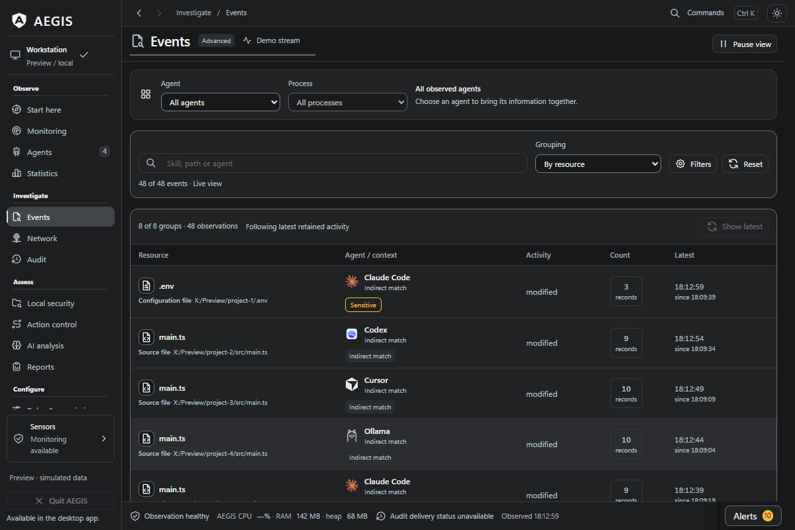
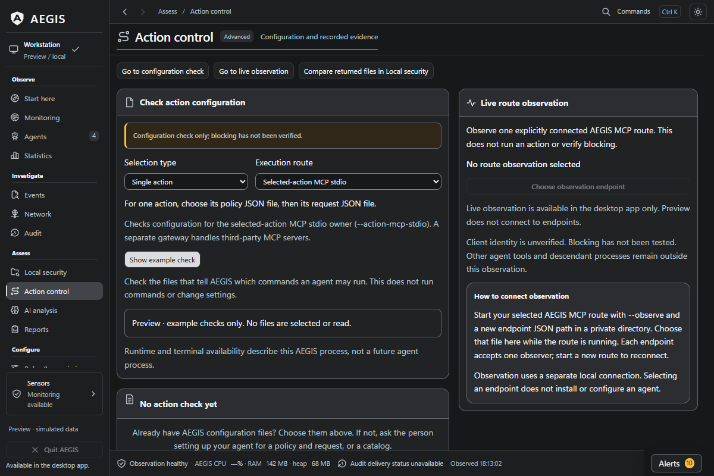
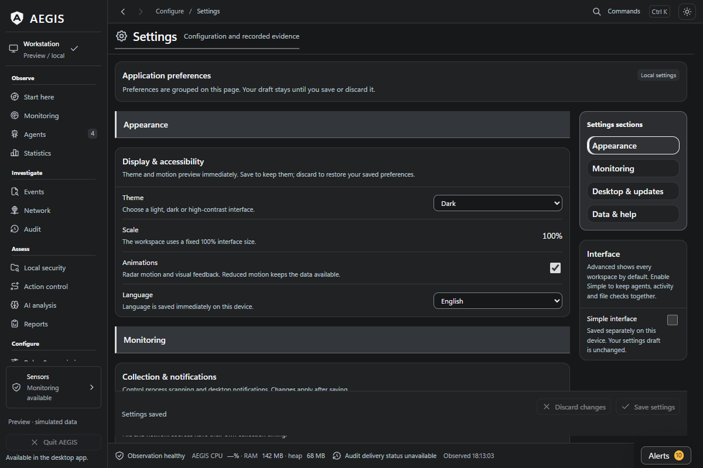

# Observatory screenshots

Captured on 11 October 2026 from [source revision d437c2f](https://github.com/antropos17/Aegis/tree/d437c2f332dc71b92a18de4febf9b8a5c06aa9cf), whose package version is 0.19.2-beta. These are source UI preview captures. Data is simulated and notification popups were dismissed through their normal controls. These images show the interface; live detection, an installed beta and automatic blocking require separate verification.

| Observe | Investigate |
| --- | --- |
|  |  |
|  |  |
|  |  |

The [Start here guide](../images/observatory-guide.png) is also captured from the same preview. To recapture these files and the [social preview](../social-preview.png) from the current source, run `node scripts/capture-screenshots.mjs` after `npm ci`.

Capture provenance, image hashes and presentation-check limits are recorded in [the receipt](capture-2026-10-11.json). The tracked social PNG is separate from the image selected in GitHub Repository Settings; this refresh does not change that selection.
